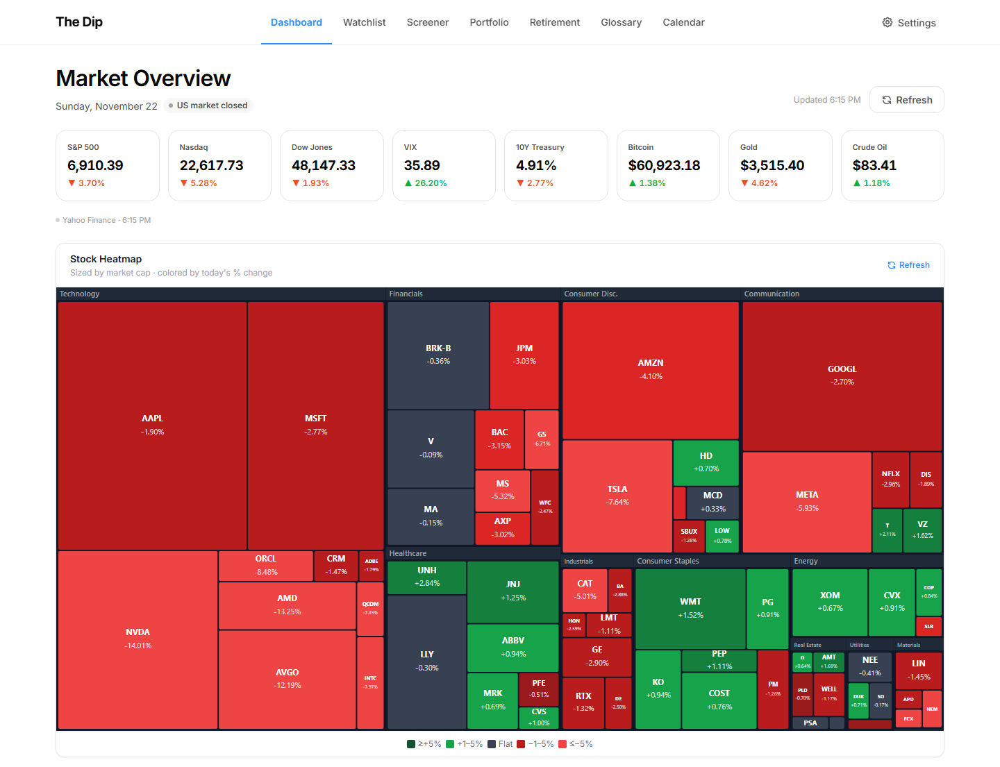

# The Dip

A personal stock research app that puts your own portfolio first, explains every number it shows, and runs entirely on free data.

Built with Next.js 14, TypeScript, Tailwind CSS and Recharts. No accounts, no database, no paid APIs.



## What it does

**Market overview dashboard.** Major indices across the top, a full-width market heatmap (sized by market cap, coloured by the day's move), trending news and tickers from across the market, and the next two major US economic releases.

**Portfolio with "your holdings today".** Value, the latest session's change, total return and money invested (in US$ or S$); a growth chart of portfolio value against money put in since your first purchase; holdings that moved ±2% or on unusual volume; headlines that name a company you own; and the next 30 days of earnings, ex-dividend dates and major US releases.

**Stock analyser.** Every ticker in the app links to `/stock/[ticker]`. It opens with **two separate conclusions**, one as a long-term investment and one as a swing trade. Each is a checklist of plain rules (growth, profits, free cash flow, debt, return on equity, valuation against the company's own history, and the long trend; or trend, RSI, volume, entry level, defined risk, volatility, MACD and earnings timing). There is no overall score. Below that: a company overview (business, sector, exchange, currency, market cap), a **research summary** of strengths, weaknesses, catalysts and risks where every point names its source and date, the price chart, technicals (moving averages, RSI, 52-week high/low, 1M–1Y returns, volatility, drawdown, volume), current fundamentals and **four years of reported financials** (revenue, earnings, margins, cash flow, debt, P/E at each year end). A **5 / 15 / 30-minute research mode** controls how deep each section goes.


**Strategy-first screener with "Why am I seeing this?"** Choose swing trading or long-term investing first, and the market (US or Singapore). Each strategy shows only its own setups (Momentum, Breakout, Pullback; or Quality growth, Reasonable value, Dividend income, Long-term leaders) and filters (swing: RSI, volume, 1-month change, earnings dates; long-term: P/E, yield, price/book, ROE, revenue growth, margins, debt; both: market cap, sector, price vs the 50/200-day averages). Every result lists the exact rules it passed, plus how it relates to your portfolio. Screens can be saved, edited, renamed and deleted, and results added to any watchlist one at a time or all at once.


**Watchlists.** Create, rename, duplicate and delete named lists. Each stock carries a status (Researching, Watching, Setup ready, Archived), a strategy, notes, a thesis, a target price and an invalidation level. The table sorts by status, price, today's move, 5-day change, volume, market cap, 52-week position, distance to target and change since added, shows prices in each listing's own currency with their timestamps, and links every stock to its analyser page.


**Interactive chart.** Every research page links to a full chart at `/stock/[ticker]/chart`: candlesticks with volume, zoom and scroll (mouse wheel, drag or pinch), and a crosshair readout of each bar's open, high, low, close, volume and change from the previous bar. Timeframes are 1D, 4H, 1H, 15m and 5m, with intraday bar times shown on the exchange's own clock (New York or Singapore). Built on TradingView's open-source [Lightweight Charts](https://github.com/tradingview/lightweight-charts) library.

An **Indicators** menu switches on moving averages (SMA 20/50/200, EMA 9/21), VWAP, average volume, relative volume, RSI (14) and MACD (12, 26, 9), each with a plain-language explanation. Averages and VWAP are drawn over the price, RSI and MACD get their own panels below it, and the readout shows every value for the bar under the crosshair. Relative volume compares a daily bar with the previous 20 sessions, and an intraday bar with the same time of day over the previous 10 sessions, since volume is always heavy at the open. VWAP restarts each session, so it is offered on intraday timeframes only. All indicators are calculated in the app from the chart's own bars.

A panel beside the chart reads the **trend** two ways and calls it only when both agree. The first is how price sits against its 50- and 200-day averages (the same rule as the research page); the second is whether the last two swing highs and lows are rising or falling. Each read lists the prices and dates it used. **Support and resistance** are found from swing points: bars whose high or low is the most extreme within 5 bars either side. Swing points within half an average bar's range of each other form one level, and each one counts as a touch. Levels need at least two touches in the last 500 bars, and only the three nearest on each side of the price are drawn (as dashed lines), so the chart stays readable. A swing point is only confirmed 5 bars after it happens, so levels never rely on later bars. You can add your own **levels** (by clicking the chart or typing a price), **trendlines** and **notes**, then edit or delete them from the panel. Your levels appear as solid lines on every timeframe and get touch counts by the same rule. Trendlines and notes stay on the timeframe they were drawn on. Drawings are saved in the browser per ticker and included in backups.

**Setups.** The panel checks five swing-trading setups: **breakout**, **pullback**, **bull flag**, **support bounce** and **golden cross**. Each is a fixed checklist. *Core rules* must all pass for the setup to count as detected; *confirmations* add evidence. Scores are plain counts shown separately (for example "Core 4/4 · Conf 2/4"), with no weights or AI confidence. Every rule shows ✓ or ✗ with the numbers behind it, and each setup names the price that would invalidate it by its own rules (for example "a close back below $110.50, the level it broke"). Each detection also says what has happened since: still valid, or invalidated on a given date (a golden cross: reversed by a death cross); bull flags are marked *forming* until price closes above the flag, then *confirmed*. A detection on a bar that is still trading is marked provisional. A setup detected in the last 10 bars (20 for a golden cross) is shown with its date and marked with an arrow on the chart; the **Looking at** picker switches between the latest bar and every detection in the past 250 bars. **Show on chart** shades the setup's bars, draws its key price and invalidation line, dots the earlier bars that formed its support or resistance level, and scrolls back to it if needed. **Inspect candles** lists every bar the result depends on, with its role (pole start, flag top, test of support, breakout bar, earlier touches of the level…), prices and volume against usual; selecting one moves the chart's crosshair to it. Every threshold can be changed under **Adjust rules** (saved in this browser, with a reset to the defaults), and the panel says when custom rules are in use. Rules only use bars up to the one being judged, so a setup never relies on later prices. Distances are measured in average bar ranges, and intraday volume is compared with the same time of day in earlier sessions, so the same rules apply on daily and intraday charts. These are descriptions of price patterns, not buy signals, and how often they work hasn't been tested yet; historical testing is planned next.

Also: portfolio tracker with sector allocation, investment-return calculator, retirement planner, economic calendar and glossary.

## Design decisions

**Every number says where it came from.** All data goes through one layer ([src/lib/data.ts](src/lib/data.ts)) that returns values as `Sourced<T>`: the value plus its provider and timestamp. The UI shows a source label next to each figure, and indicators computed in the app are labelled "Calculated from Yahoo Finance daily prices" rather than being passed off as provider data. Settings has a data-status panel showing when each feed last worked.

**Explainable screening, not a black box.** The screener's rule engine ([src/lib/rules.ts](src/lib/rules.ts)) pairs each condition with the sentence shown when it matches, so the explanation can't drift from the logic. Missing data never passes a rule.

**Your data stays on your device.** Portfolio, watchlist and settings live in the browser's IndexedDB ([src/lib/store.ts](src/lib/store.ts)), with JSON export/import for backup. Older storage formats migrate automatically.

**It degrades gracefully.** Market data comes from Yahoo Finance's unofficial endpoints, which can rate-limit or block cloud servers. The API routes fall back to a saved snapshot when a live request fails, and those values are labelled "Saved snapshot" in amber with their original timestamp, so stale data is never shown as live. The data layer also caches responses and serves its last good value if a refresh fails.

**Honest about time.** Weekend and pre-market views say "Last session (Fri, Oct 9)" rather than "Today", using the New York trading date. Earnings and dividend dates are stored as calendar dates so they don't shift a day across time zones.

## Architecture

```
Browser                                           Next.js API routes (proxy)       Upstream
┌───────────────────────────────┐                 ┌──────────────────────────┐
│ Pages (dashboard, research,   │                 │ /api/quote   /api/chart  │
│ screener, watchlist, …)       │                 │ /api/market  /api/news   │──▶ Yahoo Finance
│        │                      │   fetch         │ /api/fundamentals        │    (Stooq fallback
│        ▼                      │ ──────────────▶ │ /api/screener            │     for quotes)
│                               │                 │ /api/financials          │
│ lib/data.ts  data layer       │                 │          │ on failure    │
│  • cache in IndexedDB         │                 │          ▼               │
│  • de-duplicates requests     │                 │ lib/server/snapshot.ts   │
│  • tags source + timestamp    │                 │  saved data, labelled    │
│                               │                 └──────────────────────────┘
│ lib/store.ts  user data       │
│ lib/rules.ts  screener rules  │
│ lib/indicators.ts  RSI, MACD… │
└───────────────────────────────┘
```

| Path | Purpose |
|---|---|
| `src/lib/data.ts` | Data layer: caching, request de-duplication, source/timestamp tagging, feed health |
| `src/lib/store.ts` | IndexedDB persistence, migrations, backup export/import |
| `src/lib/rules.ts` | Swing and long-term setups, and portfolio-context reasons |
| `src/lib/screenerFilters.ts` | Screener filters per strategy, each with its explanation |
| `src/lib/analysis.ts` | Long-term and swing verdicts, and the sourced research summary |
| `src/lib/markets.ts` | Supported markets, exchanges and per-currency formatting |
| `src/lib/indicators.ts` | SMA, EMA, RSI, MACD, ATR and trend classification |
| `src/lib/marketData/` | Candle and timeframe types, the `CandleProvider` interface, exchange-time helpers, 1H → 4H grouping, data cleaning, chart indicators (VWAP, average and relative volume), swing points and support/resistance (`levels.ts`), trend reads (`trend.ts`), chart drawing types and validation (`annotations.ts`), setup rules and scanning (`setups.ts`) |
| `src/lib/server/providers/` | Candle providers (Yahoo today); `index.ts` picks which one `/api/candles` uses |
| `src/components/chart/` | Candlestick chart, timeframe picker, OHLCV and indicator readouts, indicator menu, drawing tools, and the trend, setups, levels and drawings cards beside the chart |
| `src/lib/server/news.ts` | Headline relevance scoring and duplicate-story merging |
| `src/lib/server/snapshot.ts` | Saved-data fallback for the API routes |
| `src/app/api/*` | Server routes that proxy and normalise Yahoo Finance |

## Running it

```bash
npm install
npm run dev        # http://localhost:3000
npm test           # unit tests (rules, indicators, news, portfolio history, categories, chart data, indicators, levels, trend and setups)
npm run build      # production build
```

No API keys or environment variables are required.

**Saved data for demos.** With the dev server running, `npm run snapshot` refreshes the saved data in `src/data/snapshot/` (quotes for every default ticker; full research data for nine showcase stocks). Set `DATA_MODE=snapshot` to serve only saved data, for example for a demo that must not depend on Yahoo.

## Limitations

- **Unofficial data source.** Yahoo Finance's endpoints are undocumented and can change or rate-limit without notice. Prices may be delayed, and the snapshot fallback only covers the showcase stocks in full.
- **Chart history depends on the timeframe.** Yahoo provides 5 years of daily bars here, 1-hour bars for about two years (the 4H view is built from them), and 15- and 5-minute bars for only the last 60 days. Intraday bars cover regular trading hours only. If Yahoo fails, the daily chart falls back to saved data for the showcase stocks; intraday timeframes have no fallback and say so. Yahoo has no 4-hour interval, so 4H bars run 9:30–13:30 and 13:30–16:00 for US stocks (the last one is shorter). Yahoo's terms allow personal use only: a commercial version would need a licensed provider, which can be added as another `CandleProvider`.
- **Support, resistance and trend use only the loaded bars.** On 15m and 5m charts that is at most 60 days, so those levels are short-term. The newest 5 bars can't form a swing point yet, so a fresh turn appears a few bars later, and a level can shift as new swing points are confirmed. Chart drawings live in this browser only, like the rest of your data; trendlines and notes on intraday charts disappear from view once their bars are older than Yahoo's intraday history.
- **Setup thresholds are untested defaults.** The rules (such as 1.5× volume for a breakout, or a pole of 4 average bar ranges for a bull flag) are reasonable starting points, not tuned values. Across five years of daily bars for nine large stocks, support bounces are detected about 17 times per stock per year, pullbacks about 11, bull flags about 10 (half of them confirmed), breakouts about 3 and golden crosses under 1, so a bounce or pullback alone means little until historical testing shows how these setups played out. Volume rules count as not met when the provider has no volume for a bar. "Still trading" uses regular session hours (New York 16:00, Singapore 17:00) and doesn't know about half days.
- **Hand-maintained economic calendar.** Release dates in `src/lib/economicEvents.ts` need updating from the official BLS, BEA and Federal Reserve calendars.
- **Headline matching is approximate.** News relevance matches on the company name, so a listicle that mentions a company can count as news about it.
- **Markets.** US and Singapore are supported in the screener; search also finds listings on other major exchanges (London, Hong Kong, Tokyo, Toronto, Australia and others), which work everywhere a ticker is accepted. Every watchlist item and position stores its exchange and currency. Portfolio totals convert non-USD holdings at today's exchange rate, so their cost basis is approximate.
- **Screener coverage.** When Yahoo's market-wide screener doesn't respond, the screener checks a built-in list of about 135 large US companies (or about 40 large SGX listings). Filters that need fundamentals or price history (ROE, RSI…) are looked up for the 60 largest candidates.
- **Not investment advice.** Indicators and screener rules describe price history; they don't predict it.
