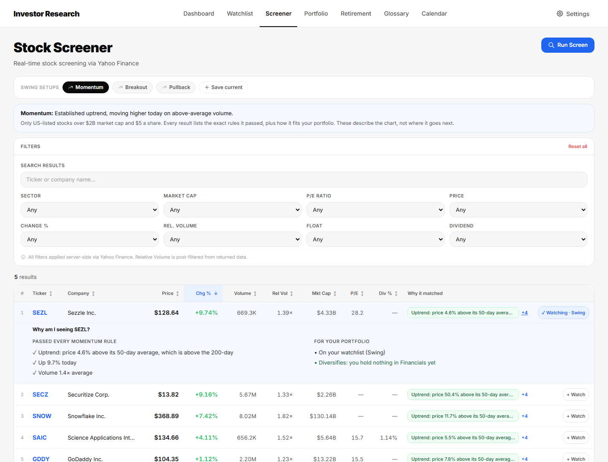

# Investor Research

A personal stock research app that puts your own portfolio first, explains every number it shows, and runs entirely on free data.

Built with Next.js 14, TypeScript, Tailwind CSS and Recharts. No accounts, no database, no paid APIs.


## What it does

**Your Day dashboard.** Opens with your portfolio: value, the latest session's change and total return (in US$ or S$), holdings that moved ±2% or on unusual volume, headlines that name a company you own, and the next 30 days of earnings, ex-dividend dates and major US economic releases. Market indices and a sector heatmap sit below as *Market Overview*.

**Stock research page.** Every ticker in the app links to `/stock/[ticker]`: price chart with 50/200-day averages, technical indicators (RSI, MACD, ATR, volume vs. average), fundamentals, upcoming events, analyst targets and de-duplicated news. A **5 / 15 / 30-minute research mode** controls how deep each section goes.


**Swing screener with "Why am I seeing this?"** Three setups (Momentum, Breakout, Pullback) defined as plain, readable rules. Every result lists the exact rules it passed, plus how it relates to your portfolio, such as concentration in an industry you already hold, or a sector you don't own yet.



**Watchlist grouped by intent.** Long-term, Swing or Research later, each stock with a "reason added" note and a research status. Adding from the screener carries the matched rules over as the note.


Also: portfolio tracker with sector allocation, investment-return calculator, retirement planner, economic calendar and glossary.

## Design decisions

**Every number says where it came from.** All data goes through one layer ([src/lib/data.ts](src/lib/data.ts)) that returns values as `Sourced<T>`: the value plus its provider and timestamp. The UI shows a source label next to each figure, and indicators computed in the app are labelled "Calculated from Yahoo Finance daily prices" rather than being passed off as provider data. Settings has a data-status panel showing when each feed last worked.

**Explainable screening, not a black box.** The screener's rule engine ([src/lib/rules.ts](src/lib/rules.ts)) pairs each condition with the sentence shown when it matches, so the explanation can't drift from the logic. Missing data never passes a rule.

**Your data stays on your device.** Portfolio, watchlist and settings live in the browser's IndexedDB ([src/lib/store.ts](src/lib/store.ts)), with JSON export/import for backup. Older storage formats migrate automatically.

**It degrades gracefully.** Market data comes from Yahoo Finance's unofficial endpoints, which can rate-limit or block cloud servers. The API routes fall back to a saved snapshot when a live request fails, and those values are labelled "Saved snapshot" in amber with their original timestamp, so stale data is never shown as live. The data layer also caches responses and serves its last good value if a refresh fails.

**Honest about time.** Weekend and pre-market views say "Last session (Fri, Oct 9)" rather than "Today", using the New York trading date. Earnings and dividend dates are stored as calendar dates so they don't shift a day across time zones.

## Architecture

```
Browser                                           Next.js API routes (proxy)       Upstream
┌───────────────────────────────┐                 ┌──────────────────────────┐
│ Pages (dashboard, research,   │                 │ /api/quote   /api/chart  │
│ screener, watchlist, …)       │                 │ /api/market  /api/news   │──▶ Yahoo Finance
│        │                      │   fetch         │ /api/fundamentals        │    (Stooq fallback
│        ▼                      │ ──────────────▶ │ /api/finviz (screener)   │     for quotes)
│ lib/data.ts  data layer       │                 │          │ on failure    │
│  • cache in IndexedDB         │                 │          ▼               │
│  • de-duplicates requests     │                 │ lib/server/snapshot.ts   │
│  • tags source + timestamp    │                 │  saved data, labelled    │
│                               │                 └──────────────────────────┘
│ lib/store.ts  user data       │
│ lib/rules.ts  screener rules  │
│ lib/indicators.ts  RSI, MACD… │
└───────────────────────────────┘
```

| Path | Purpose |
|---|---|
| `src/lib/data.ts` | Data layer: caching, request de-duplication, source/timestamp tagging, feed health |
| `src/lib/store.ts` | IndexedDB persistence, migrations, backup export/import |
| `src/lib/rules.ts` | Swing setups and portfolio-context reasons |
| `src/lib/indicators.ts` | SMA, EMA, RSI, MACD, ATR and trend classification |
| `src/lib/server/news.ts` | Headline relevance scoring and duplicate-story merging |
| `src/lib/server/snapshot.ts` | Saved-data fallback for the API routes |
| `src/app/api/*` | Server routes that proxy and normalise Yahoo Finance |

## Running it

```bash
npm install
npm run dev        # http://localhost:3000
npm test           # unit tests (rules, indicators, news de-duplication)
npm run build      # production build
```

No API keys or environment variables are required.

**Saved data for demos.** With the dev server running, `npm run snapshot` refreshes the saved data in `src/data/snapshot/` (quotes for every default ticker; full research data for nine showcase stocks). Set `DATA_MODE=snapshot` to serve only saved data, for example for a demo that must not depend on Yahoo.

## Limitations

- **Unofficial data source.** Yahoo Finance's endpoints are undocumented and can change or rate-limit without notice. Prices may be delayed, and the snapshot fallback only covers the showcase stocks in full.
- **Hand-maintained economic calendar.** Release dates in `src/lib/economicEvents.ts` need updating from the official BLS, BEA and Federal Reserve calendars.
- **Headline matching is approximate.** News relevance matches on the company name, so a listicle that mentions a company can count as news about it.
- **US-listed stocks only.** Values are converted to S$ at today's exchange rate, so S$ cost basis is approximate.
- **Not investment advice.** Indicators and screener rules describe price history; they don't predict it.
