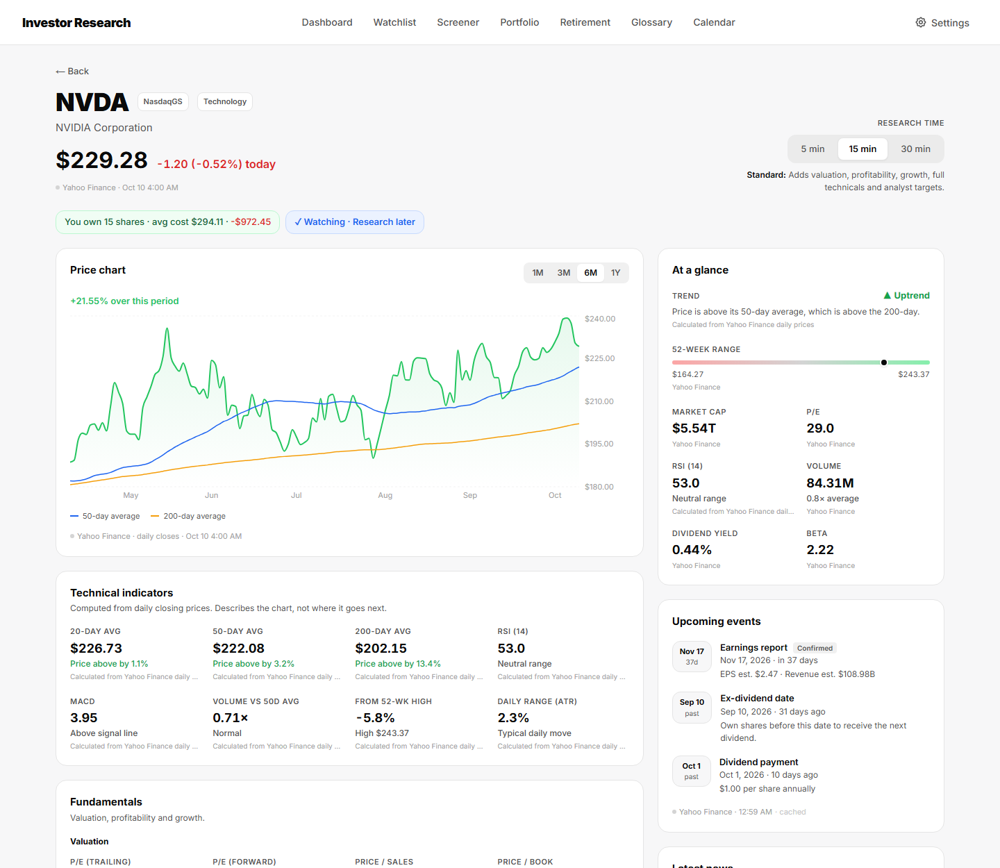
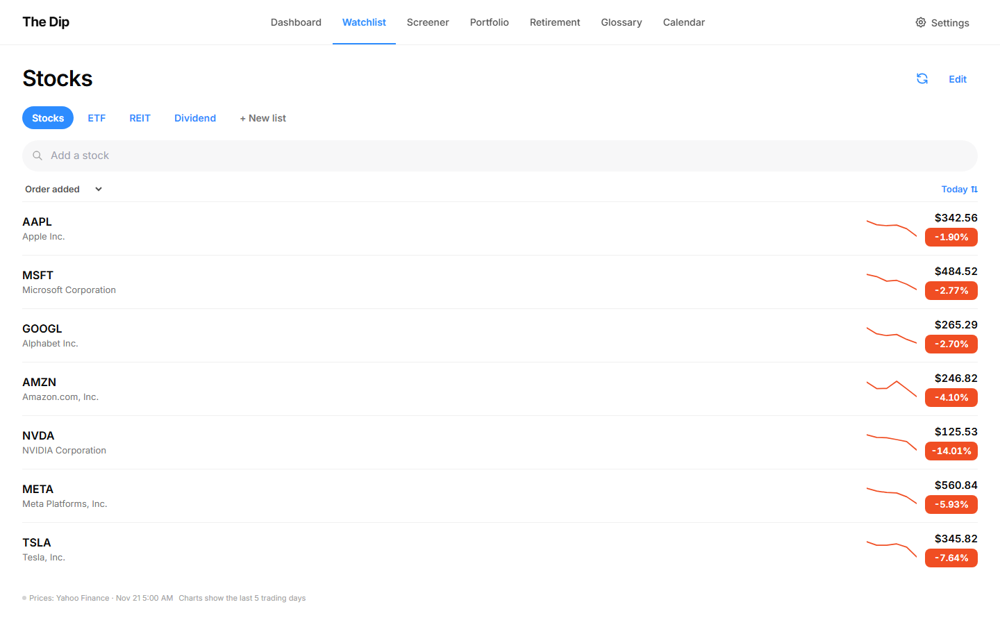
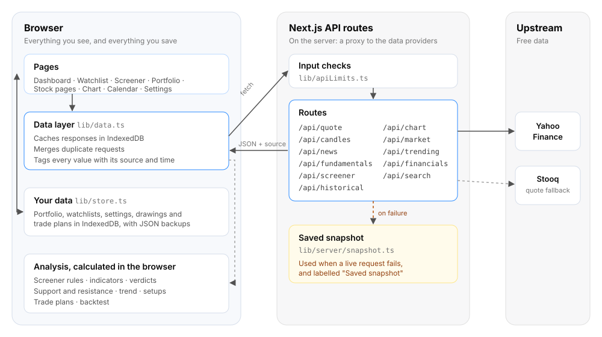

# The Dip

> A personal stock research app that puts your own portfolio first, explains every number it shows, and runs entirely on free data.


## Overview

### Introduction

<!-- Draft written from what the app is built around: edit it into your own words. -->

The Dip is a stock research app for one person's own investing. It brings market data, research, screening, watchlists, a portfolio tracker and an interactive chart into one place, and judges every stock against your own holdings and strategy.

It addresses three problems with the research tools I had been using:

- **Verdicts without reasons.** Many tools give a score or a rating but not the rules behind it. In The Dip every rating, setup and screener result lists the exact rules it passed, with the numbers and where they came from.
- **Paid data.** Useful tools often sit behind a subscription. The Dip uses only free data, has no accounts, and needs no API keys.
- **Your portfolio as an afterthought.** Most tools look at a stock on its own. The Dip shows how a stock relates to what you already own, and judges it by your strategy (long-term investing or swing trading).

The main objective was an app I could trust: one that says where every number comes from, never shows old data as live, and tests trading ideas honestly before claiming anything about them.

### Motivation

<!-- Draft: replace with what actually inspired you. -->

I wanted one place to check a stock against my own portfolio and strategy, instead of moving between a broker, a charting site and a news app. Building it was also a way to learn how indicators, chart patterns and backtests really work by implementing each one myself, and to see whether common setups would actually have made money on a stock once trading costs are counted and no future prices leak into the test.

## Features

1. **Market overview dashboard**
   - The S&P 500, Nasdaq, Dow Jones, VIX, 10-year Treasury yield, Bitcoin, gold and oil across the top.
   - A full-width market heatmap: each stock sized by market cap and coloured by the day's move, grouped by sector.
   - Trending news and tickers from across the market, and the next two major US economic releases.

2. **Portfolio with "your holdings today"**
   - Value, the latest session's change, total return and money invested, in US$ or S$, with sector allocation.
   - A growth chart of portfolio value against the money put in since your first purchase.
   - Holdings that moved ±2% or on unusual volume, headlines that name a company you own, and the next 30 days of earnings, ex-dividend dates and major US releases.
   - When you add a position, **Fetch** fills in the closing price on the purchase date (or the next trading day), adjusted for later stock splits, and says which day and source it used.

3. **Stock analyser**
   - Every ticker in the app links to its research page at `/stock/[ticker]`.
   - It opens with **one Buy / Hold / Sell call for your strategy**: long-term or swing, taken from the stock's watchlist tag or else from Settings. Each tab's numbers are rated green, grey or red against your benchmarks and weighted for that strategy, and one click shows the call as the other strategy instead.
   - A checklist lists the plain rules behind the call: growth, profits, free cash flow, debt, return on equity, valuation against the company's own history and the long trend; or trend, RSI, volume, entry level, defined risk, volatility, MACD and earnings timing.
   - A research summary of strengths, weaknesses, catalysts and risks, where every point names its source and date.
   - The price chart, technicals (moving averages, RSI, 52-week high and low, 1M–1Y returns, volatility, drawdown, volume), current fundamentals, and four years of reported financials (revenue, earnings, margins, cash flow, debt, P/E at each year end).

4. **Strategy-first screener with "Why am I seeing this?"**
   - Choose long-term investing or swing trading first (it starts on the strategy from Settings), and the market (US or Singapore).
   - Each strategy shows only its own ideas (Quality growth, Reasonable value, Dividend income, Long-term leaders; or Momentum, Breakout, Pullback) and its own filters (long-term: P/E, yield, price/book, ROE, revenue growth, margins, debt; swing: RSI, volume, 1-month change, earnings dates; both: market cap, sector, price against the 50- and 200-day averages).
   - Every result lists the exact rules it passed, plus how it relates to your portfolio. On a laptop the key numbers line up in columns.
   - Screens can be saved, edited, renamed and deleted, and results added to any watchlist one at a time or all at once.

5. **Watchlists**
   - Named lists (Stocks, ETF, REIT and Dividend to start) that you can add to, rename and delete.
   - Searching for a stock shows a quick look first (price, 52-week range, market cap, P/E, dividend, analyst target and a business summary), so you can check it before adding it.
   - Each row shows a badge and tag coloured by sector, the ticker, your note or the company name, a 5-day price line, the price in the listing's own currency, and a pill with either today's move or the change since you added it. The other figure sits under the price line, with the date the stock was added.
   - Lists sort by order added, A–Z or biggest movers, and the sort, the pill and the open list are remembered. **Edit** removes stocks, adds a note to each one, renames the list or deletes it.
   - A stock added with **+ Watch** from the Screener or a stock page keeps a note and the strategy it was found under, and its stock page judges it by that strategy.

6. **Interactive chart and indicators**
   - A full chart for every stock at `/stock/[ticker]/chart`, built on TradingView's open-source [Lightweight Charts](https://github.com/tradingview/lightweight-charts): candlesticks with volume, zoom and scroll (mouse wheel, drag or pinch), and a crosshair readout of each bar's open, high, low, close, volume and change.
   - Timeframes of 1D, 4H, 1H, 15m and 5m, with intraday bar times on the exchange's own clock (New York or Singapore).
   - An **Indicators** menu with moving averages (SMA 20/50/200, EMA 9/21), VWAP, average volume, relative volume, RSI (14) and MACD (12, 26, 9), each with a plain-language explanation. Averages and VWAP are drawn over the price, and RSI and MACD get their own panels.
   - Relative volume compares an intraday bar with the same time of day in earlier sessions, since volume is always heavy at the open. Every indicator is calculated in the app from the chart's own bars.

7. **Trend, support and resistance, and your own drawings**
   - The trend is read two ways and called only when both agree: price against its 50- and 200-day averages, and whether the last two swing highs and lows are rising or falling. Each read lists the prices and dates it used.
   - Support and resistance levels are found from swing points (the most extreme high or low within 5 bars either side). Nearby swing points merge into one level, a level needs at least two touches, and only the three nearest on each side of the price are drawn.
   - You can add your own levels, trendlines and notes, then edit or delete them. They're saved per ticker and included in backups.

8. **Setups**
   - Five swing-trading setups are checked: breakout, pullback, bull flag, support bounce and golden cross. Each is a fixed checklist of core rules (all must pass) and confirmations (extra evidence), scored as plain counts such as "Core 4/4 · Conf 2/4".
   - Every rule shows ✓ or ✗ with the numbers behind it, and each setup names the price that would invalidate it.
   - Each detection says what has happened since: still valid, or invalidated on a given date. A detection on a bar that is still trading is marked provisional.
   - **Show on chart** shades the setup's bars and draws its key levels. **Inspect candles** lists every bar the result depends on and its role. Every threshold can be changed under **Adjust rules**.
   - Rules only use bars up to the one being judged, so a setup never relies on later prices. They describe price patterns; they aren't buy signals.

9. **Trade plans**
   - Plan a hypothetical trade by clicking the entry, stop and target on the chart, from a detected setup, or by typing the prices. Long and short plans are supported.
   - The plan works out risk and reward per share, the risk-to-reward ratio, distances to the stop and target, and, with a share count or a risk budget, the potential loss, profit and position value.
   - The entry, stop and target are drawn on the chart with the reward zone in green and the risk zone in red. Plans are saved per ticker and included in backups. They place no orders.

10. **Setup backtest**
    - Every setup detected in the loaded bars is traded through a simulated account, so you can see how each would have done on that stock in the past, after costs.
    - A trade buys at the open of the bar after the signal, with the setup's own invalidation level as the stop and twice the risk as the target. It sells at the stop, the target or the close after 20 bars, whichever comes first.
    - Every trade pays brokerage and slippage. Each trade risks 1% of the balance, and setups can be tested in their own accounts or one combined account.
    - The first 70% of the bars are a training period and the rest a testing period, so rules adjusted on one can be checked on the other.
    - The report covers win rate, average win and loss, expectancy in R, profit factor, maximum drawdown, return and costs, with a balance chart and every trade listed. Setups with fewer than 30 trades are flagged, and the stock's own move is shown for comparison.

11. **Also included**
    - A retirement planner, an economic calendar of major US releases, and a glossary of investing terms.
    - Settings for your strategy, base currency (US$ or S$) and the benchmarks behind every rating, plus JSON backup and restore of all your data.

## Project Demonstration



The research page for Apple. The header shows the price and today's move, the position held in the sample portfolio, and a 6-month price line. Four headline numbers are coloured against the benchmarks. Below the tabs, the verdict card gives one call ("Hold") for the strategy chosen in Settings: green, grey and red bars show how each tab's numbers rated, and a link switches the view to a swing trade.


The screener on long-term investing in the US market. The ideas across the top are this strategy's preset screens, and the results show each stock's market cap, P/E and dividend in columns, with its price and 1-year change.



The Stocks watchlist. Each row has a badge and tag coloured by sector, a 5-day price line, the price and today's move, and, under the line, how long the stock has been watched.

## Technical Implementation

### Technologies Used

- **Programming language:** TypeScript
- **Framework:** Next.js 16 (App Router) with React 19
- **Libraries:** Tailwind CSS, Recharts (research, financials, portfolio and retirement charts), TradingView Lightweight Charts (the interactive chart)
- **Data:** Yahoo Finance's public endpoints, with Stooq as a fallback for quotes; IndexedDB in the browser for caching and your own data
- **Tools:** Vitest (unit tests), Playwright (browser tests), ESLint, GitHub Actions (automatic checks), Vercel (hosting)

### System Architecture



Everything you see and save lives in the browser. Pages ask the data layer ([src/lib/data.ts](src/lib/data.ts)) for market data. It returns cached values from IndexedDB when they're fresh, merges duplicate requests, and tags every value with its source and time. Otherwise it fetches from the app's own API routes. Your portfolio, watchlists, settings, drawings and trade plans are stored separately ([src/lib/store.ts](src/lib/store.ts)). Indicators, ratings, setups and backtests are all calculated in the browser from the prices it receives.

The Next.js API routes run on the server as a proxy. Each one checks its inputs ([src/lib/apiLimits.ts](src/lib/apiLimits.ts)), asks Yahoo Finance, and normalises the answer. If a live request fails, it serves saved snapshot data instead ([src/lib/server/snapshot.ts](src/lib/server/snapshot.ts)), labelled as such.

| Path | Purpose |
|---|---|
| `src/lib/data.ts` | Data layer: caching, request de-duplication, source and timestamp tagging, feed health |
| `src/lib/store.ts` | IndexedDB persistence, migrations, backup export and import |
| `src/lib/rules.ts` | Screener setups for both strategies, and portfolio-context reasons |
| `src/lib/screenerFilters.ts` | Screener filters per strategy, each with its explanation |
| `src/lib/analysis.ts` | Long-term and swing verdicts, and the sourced research summary |
| `src/lib/markets.ts` | Supported markets, exchanges and per-currency formatting |
| `src/lib/indicators.ts` | SMA, EMA, RSI, MACD, ATR and trend classification |
| `src/lib/tradePlan.ts` | Trade plan maths (risk, reward, ratio, sizing), validation, plans from setups |
| `src/lib/marketData/` | Candles and timeframes, the `CandleProvider` interface, exchange-time helpers, 1H → 4H grouping, data cleaning, chart indicators, support and resistance, trend, drawings, setups, single-trade replay and the backtest |
| `src/lib/server/providers/` | Candle providers (Yahoo today); `index.ts` picks which one `/api/candles` uses |
| `src/lib/server/news.ts` | Headline relevance scoring and duplicate-story merging |
| `src/lib/server/snapshot.ts` | Saved-data fallback for the API routes |
| `src/lib/apiLimits.ts` | What the API routes accept: a malformed ticker, more than 20 tickers in one quote request, search text over 50 characters, a company name over 200 or an unknown market gets a 400 before any provider is asked |
| `src/app/api/*` | Server routes that proxy and normalise Yahoo Finance |
| `src/components/chart/` | The candlestick chart, its readouts, indicator menu and drawing tools, and the trend, setups, trade plan, levels, drawings and backtest cards |

### Implementation Details

- **Every number says where it came from.** All data passes through one layer that returns values as `Sourced<T>`: the value plus its provider and timestamp. The page shows a source label next to each figure, and indicators calculated in the app are labelled "Calculated from Yahoo Finance daily prices" rather than passed off as provider data.
- **Explainable rules, not a black box.** The screener's rule engine ([src/lib/rules.ts](src/lib/rules.ts)) pairs each condition with the sentence shown when it matches, so an explanation can't drift from its logic. Missing data never passes a rule.
- **Your data stays on your device.** Portfolio, watchlists and settings live in the browser's IndexedDB, with JSON export and import for backup. Older storage formats migrate automatically.
- **It degrades gracefully.** When a live request fails, the API routes serve saved snapshot data, shown in amber as "Saved snapshot" with its original timestamp, so old data is never shown as live. The data layer also keeps its last good value if a refresh fails.
- **Honest about time.** Weekend and pre-market views say "Last session (Fri, Oct 9)" rather than "Today", using the New York trading date. Earnings and dividend dates are stored as calendar dates, so they don't shift a day across time zones.
- **No look-ahead in the backtest.** Each signal is judged on its own bar and the bars before it only, and its entry, stop and target are fixed at that point. Exits are checked bar by bar, and a bar that reaches both the stop and the target counts as the stop.
- **Choices remembered without effects.** Saved preferences such as the chart's timeframe and indicators are read from browser storage through a small `useSyncExternalStore` hook ([src/hooks/useStoredState.ts](src/hooks/useStoredState.ts)), so pages render the saved choice without an extra update after loading.

## Challenges & Solutions

### Challenge 1: Data that doesn't fit the chart

**Problem:** Yahoo Finance has no 4-hour interval. Its intraday data also ends with an extra, off-schedule "live" tick, and can contain bars with no prices, bars out of order or repeated times, none of which the chart library accepts.

**Solution:** 4-hour bars are built from 1-hour bars within each trading day, anchored at the market open. The trailing tick is folded into the bar before it, and a cleaning step sorts the bars, keeps the later of two bars at the same time, and drops bars with missing prices. Each step has unit tests.

### Challenge 2: Time zones and trading days

**Problem:** A daily bar dated by its UTC timestamp can land on the wrong day for a Singapore stock. Shifting intraday times to the exchange's clock can create duplicate times when daylight saving ends. And at the weekend, "today's move" is really Friday's.

**Solution:** Daily bars are stamped at midnight UTC of the exchange's own trading date, and intraday times are shown on the exchange's clock, falling back to UTC if that would create duplicates. Views that aren't live say "Last session" with the New York trading date.

### Challenge 3: An unofficial, unreliable data source

**Problem:** Yahoo's endpoints are undocumented and can rate-limit or block cloud servers without warning, which would leave the app empty.

**Solution:** The API routes fall back to saved snapshot data when a live request fails, and every value carries its source and timestamp, so saved data is always labelled as saved. The data layer caches responses and keeps its last good value when a refresh fails, and Settings shows when each feed last worked.

### Challenge 4: Backtests that flatter themselves

**Problem:** It's easy for a backtest to use information that wasn't available at the time, such as trading at the close of the bar that produced the signal, or tuning rules on the same bars they're judged on. Either one makes results look better than they could have been.

**Solution:** A trade enters at the open of the next bar, every exit is checked bar by bar (stop first when a bar hits both), every trade pays costs, and bars still forming are left out. The bars are split into training and testing periods, and the report flags setups with too few trades to mean much.

### Challenge 5: Browser tests on moving prices

**Problem:** Browser tests that check indicator values and setups against live prices would give different results every day, and fail whenever Yahoo was slow.

**Solution:** The tests serve the chart from real bars recorded once into `e2e/fixtures/`, so results don't change as prices move. A separate, small set of checks runs against live data.

### Challenge 6: Upgrading to Next.js 16 and React 19

**Problem:** The upgrade brought new React Compiler lint rules, which flagged 23 places where components set state inside effects or memoised in a way the compiler couldn't keep.

**Solution:** Each case was reworked: saved choices are read straight from storage, each chart view starts fresh per ticker, and pages start in a loading state and update only when data arrives. The rules are now errors, so new cases fail the automatic checks.

## Results & Key Learnings

**Accomplished:**

- A full research workflow (dashboard, screener, watchlists, research pages, charts, portfolio) that runs on free data with no accounts or API keys.
- Every rating, setup and screener result explains itself with the rules and numbers behind it.
- A backtest that trades setups through a simulated account with costs, position sizing and separate training and testing periods.
- 245 unit tests and 32 browser tests, run with the type check, lint and production build on every pull request.

<!-- Draft: adjust to what you feel you learned. -->

**Key learnings:**

- Free data needs a fallback and honest labels: the hard part isn't fetching data, it's handling the times it's missing, late or saved.
- Look-ahead bias is easy to introduce by accident, and a backtest is only as trustworthy as the rules that prevent it.
- Explaining a verdict is as much work as computing it, and doing both from the same rule definitions keeps them from drifting apart.
- Testing against recorded data makes browser tests reliable enough to run on every change.

## Future Improvements

- **A licensed data provider.** Yahoo's terms allow personal use only. The chart already reads candles through a `CandleProvider` interface, so a licensed provider can be added alongside Yahoo.
- **Backtests across many stocks.** Testing a setup on one stock gives few trades. Running it across a list, with dividends included, would give more meaningful results.
- **Check trade plans against what happened.** Saved plans aren't yet compared with how the price actually moved afterwards.
- **More markets in the screener.** Search already finds London, Hong Kong, Tokyo and other listings, but the screener covers only the US and Singapore.
- **An updating economic calendar.** Release dates are copied by hand from the official calendars and run to April 2027.
- **More use of wide screens.** Watchlist rows could show extra columns (such as market cap or P/E) when there's room.

### Current limitations

- **Unofficial data source.** Yahoo Finance's endpoints are undocumented and can change or rate-limit without notice. Prices may be delayed, and the snapshot fallback only covers the showcase stocks in full.
- **Chart history depends on the timeframe.** Yahoo provides 5 years of daily bars, about two years of 1-hour bars (the 4H view is built from them), and only the last 60 days of 15- and 5-minute bars. Intraday bars cover regular trading hours only, and intraday timeframes have no saved fallback. For US stocks the two 4H bars run 9:30–13:30 and 13:30–16:00.
- **Support, resistance and trend use only the loaded bars.** On 15m and 5m charts that is at most 60 days. The newest 5 bars can't form a swing point yet, so a fresh turn appears a few bars later.
- **Setup thresholds are untested defaults.** The rules (such as 1.5× volume for a breakout) are reasonable starting points, not tuned values. Across five years of daily bars for nine large stocks, support bounces are detected about 17 times per stock per year, pullbacks about 11, bull flags about 10, breakouts about 3 and golden crosses under 1, so a bounce or pullback alone means little.
- **Hand-maintained economic calendar.** Release dates in `src/lib/economicEvents.ts` come from the official BLS, BEA, Census and Federal Reserve calendars and run to April 2027. When the list ends within 30 days, the dashboard, portfolio and calendar say so.
- **Approximate headline matching.** News relevance matches on the company name, so a listicle that mentions a company can count as news about it.
- **Markets and currencies.** Portfolio totals convert non-USD holdings at today's exchange rate, so their cost basis is approximate. When Yahoo's market-wide screener doesn't respond, the screener checks a built-in list of about 135 large US companies (or about 40 large SGX listings).
- **Simplified trade plans.** They leave out commissions, slippage, gaps through the stop and fractional shares.
- **A small, simplified backtest.** It covers one stock and only the loaded bars, so most setups have few trades. Costs are flat estimates, there are no dividends or taxes, the order of the high and low within a bar is unknown, and stocks that still trade today are survivors, which flatters any test. Past results don't guarantee future ones.
- **Not investment advice.** Indicators and screener rules describe price history; they don't predict it.

## Installation & Usage

**Requirements:** Node.js 24 and npm. No API keys or environment variables are needed.

```bash
git clone https://github.com/j162c06cl/Personal-Proj.git
cd Personal-Proj
npm install
npm run dev        # open http://localhost:3000
```

Start on the **Dashboard**, search for any ticker to open its research page, and use **+ Watch** to add stocks to a watchlist. Set your strategy and base currency in **Settings**. Everything you save stays in your browser; use **Export backup** in Settings to keep a copy.

**Other commands:**

```bash
npm test               # unit tests (rules, indicators, news, portfolio history, calendar, purchase prices, chart data, levels, trend, setups, trade plans, backtests)
npm run typecheck      # TypeScript, no output files
npm run lint           # ESLint with Next.js's recommended rules
npm run build          # production build
npm run test:e2e       # browser tests (first time: npx playwright install chromium)
npm run test:e2e:live  # a few browser checks against live Yahoo data
npm run snapshot       # refresh the saved fallback data (with the dev server running)
```

**Browser tests.** [e2e/](e2e/) drives the app in Chromium with Playwright, at desktop and phone width. It covers:

- the chart (crosshair, zoom, scrolling, timeframes, auto-refresh, broken data), indicators, levels and drawings, setups and trade plans;
- the backtest, including a trade worked out by hand;
- the economic calendar and the purchase-price lookup;
- page layout: pages filling the screen's width, the watchlist, the stock page's single verdict, the screener's strategy and columns, and Settings.

`npm run test:e2e` builds the app into `.next-e2e` (so it can run alongside `npm run dev`), starts it on port 3123, and serves the charts from real bars recorded in [e2e/fixtures/](e2e/fixtures/). `npm run test:e2e:record` re-records those bars from a running dev server. A failing run leaves an HTML report in `playwright-report/`.

**Automatic checks.** Every pull request, and every push to `main`, runs the type check, lint, unit tests, production build and browser tests on GitHub Actions ([.github/workflows/checks.yml](.github/workflows/checks.yml)).

**Demo mode.** Set `DATA_MODE=snapshot` to serve only saved data, for a demo that must not depend on Yahoo. The saved data in `src/data/snapshot/` covers quotes for every default ticker and full research data for nine showcase stocks.

## Author

[j162c06cl](https://github.com/j162c06cl)

Personal Project | 2026
